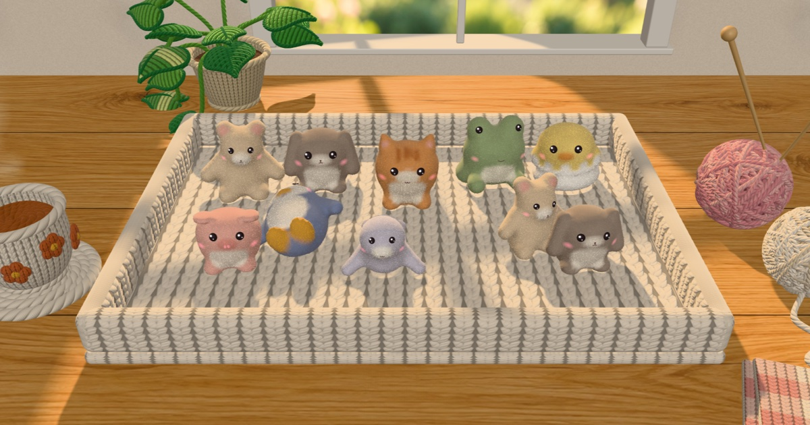
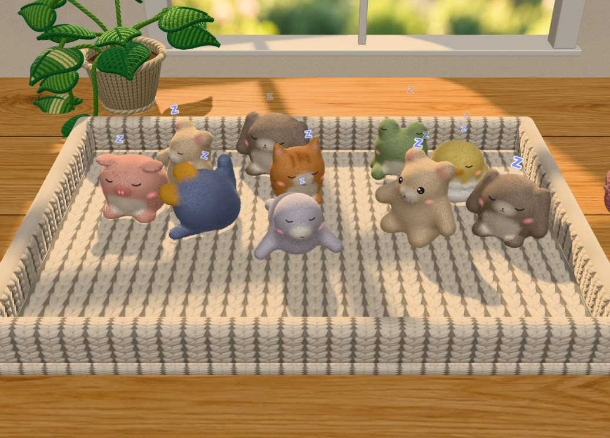
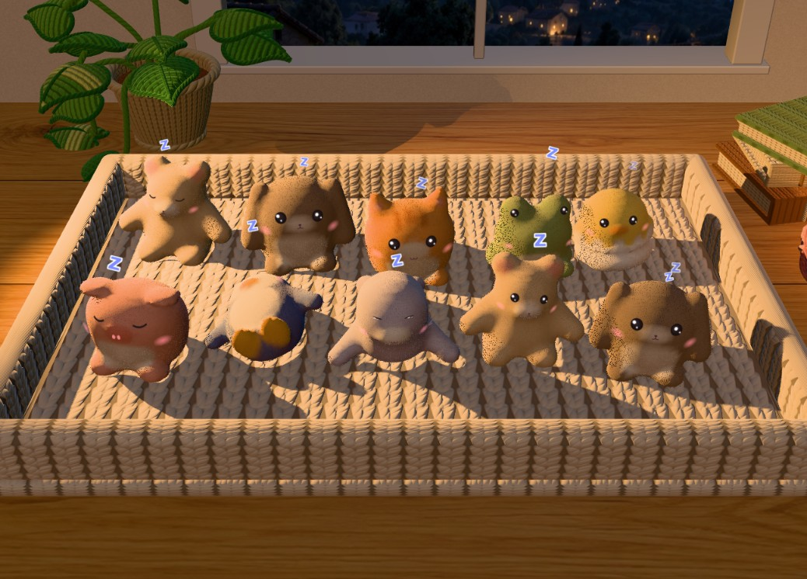

<div align="center">

# 🧸 Jelly Zoo

### An Interactive 3D Soft-Body Animal Playground

*Poke, squash, drag, pet and toss adorable needle-felted creatures in a cozy knitted basket.*



| ☀️ Daytime Mode | 🌙 Cozy Night Mode |
| :---: | :---: |
|  |  |

[](LICENSE)
[](https://threejs.org/)
[](https://vitejs.dev/)
[]()

</div>

---

## ✨ Features

| Feature | Description |
|---|---|
| 🫧 **Shape-Matching Soft-Body Physics** | Custom particle engine with quaternion polar decomposition and spatial-hash broadphase collision — every animal squishes, bounces, and jiggles realistically |
| 🐑 **Needle-Felted Shell Fur** | 5-layer instanced GLSL shell fur with 3D fiber noise and interactive fur combing when you pet them |
| 🐾 **8 Procedural SDF Species** | Bear, bunny, cat, frog, chick, pig, penguin, and seal — generated via smooth-minimum Signed Distance Fields and surface-net extraction |
| 😊 **Expressive Faces & Behaviors** | Procedural 2D canvas expression atlas with blinking, pupil tracking, blushing, cuddling, dizzy stars, and sleepy Z's |
| 🧶 **Procedural Knitted Props** | Real-time 512×512 knitted stitch normal/AO/roughness maps (stockinette, rib, garter, seed, cable, bouclé) with dynamic day/night room lighting |
| 🔊 **Procedural WebAudio Synth** | Real-time pentatonic chimes, soft bounces, chirps, stretch creaks, cat purrs, and basket shakes with convolution reverb |

---

## 🎮 Controls & Interactions

| Action | Mouse / Keyboard | Touch / Mobile |
|---|---|---|
| **Poke** | Click an animal | Tap an animal |
| **Squash & Launch** | Click & hold on an animal, then release | Press & hold, then release |
| **Drag & Toss** | Click & drag an animal | Touch & drag |
| **Pet & Comb Fur** | Hover & stroke across an animal | — |
| **Tilt Basket** | Drag basket rim or use Arrow keys | Drag basket rim or tilt device |
| **Shake Basket** | Press `Space` | — |
| **Spawn More** | Click & hold on basket floor | Touch & hold on basket floor |
| **Orbit / Zoom** | Right-drag / Scroll wheel | Two-finger pinch / drag |

URL query parameters: `?time=day` or `?time=night` to force lighting mode, `?n=12` to set initial animal count.

---

## 🛠️ Tech Stack

```
Three.js         → WebGL 2 rendering, shadows, PMREM lighting
Soft-Body Engine → Position-based shape matching + spatial hash collisions
GLSL Shaders     → Multi-layer instanced shell fur & brushed wool highlights
Procedural Maps  → Knitted yarn height/normal/AO/roughness & canvas face atlas
Web Audio API    → Zero-asset procedural sound synthesis & reverb
Vite             → Fast dev server & esbuild production bundling
```

---

## 🚀 Getting Started

### Prerequisites

- [Node.js](https://nodejs.org/) v18 or higher
- npm

### Installation

```bash
# Clone the repository
git clone https://github.com/Sunil56224972/jellycuties.git
cd jellycuties

# Install dependencies
npm install

# Start development server
npm run dev
```

The app will open at `http://localhost:3000`.

### Build for Production

```bash
npm run build
```

Builds optimized assets into `dist/` (and mirrors to `site/`).

---

## 📁 Project Structure

```
jellycuties/
├── src/
│   ├── main.js                 # Main loop, controls, interactions & AI behaviors
│   ├── index.html              # HTML entry template
│   ├── physics/
│   │   ├── softbody.js         # Shape-matching soft-body engine & spatial hash
│   │   └── skinning.js         # 4-nearest-particle mesh & face anchor skinning
│   ├── models/
│   │   ├── species.js          # 8 SDF animal species & surface-net mesher
│   │   └── face.js             # Procedural 2D canvas expression atlas & tracking
│   ├── shaders/
│   │   └── felt.js             # Felt material, instanced shell fur & combing
│   ├── materials/
│   │   └── yarn.js             # Procedural knitted stitch texture synthesizer
│   ├── effects/
│   │   └── particles.js        # Hearts, stars, sparkles, puffs & dizzy ring
│   ├── audio/
│   │   └── sound.js            # Procedural WebAudio synthesizer & reverb
│   └── scene/
│       └── environment.js      # Room, window lighting, day/night props & basket
├── public/
│   ├── og.jpg                  # Open Graph preview image
│   └── tex/                    # Tabletop wood & window sky backdrops
├── scripts/
│   └── sync-site.js            # Mirrors dist/ build output to site/
├── docs/
│   └── screenshot.jpg          # README showcase screenshot
├── vite.config.js              # Vite configuration
├── vercel.json                 # Vercel deployment config
├── package.json
├── LICENSE
└── README.md
```

---

## 🤝 Contributing

Contributions are welcome! See [CONTRIBUTING.md](CONTRIBUTING.md) for guidelines.

---

## 📄 License

This project is licensed under the MIT License — see the [LICENSE](LICENSE) file for details.

---

<div align="center">

**Built with ❤️ by [Sunil](https://github.com/Sunil56224972)**

*If you enjoyed this project, consider giving it a ⭐!*

</div>
